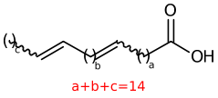
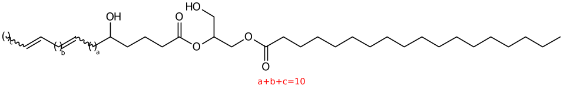

# Stage 3 with EAD: within-chain localization

Stage 3 begins only after stages 1 and 2 have produced an eligible lipid assignment. It does **not** repair a missing or weak stage-2 identification. Its role is to evaluate within-chain C=C positions and, with EAD2, supported oxygen-site hypotheses.



## What stage 3 reports

- **ID level 3:** individual positional isomer candidates that remain credible for a feature.
- **ID level 4:** an aggregate, evidence-aware consensus across retained level-3 candidates.

For a lipid initially identified as `PC 16:0_18:1`, level 3 may contain multiple candidates such as `PC 16:0_18:1(9)` and `PC 16:0_18:1(11)`. Level 4 names a position only when the configured assertion rule is met; otherwise it preserves the unlocalized chain and reports the evidence distribution in the confidence tail.

## Select an EAD engine

```yaml
WORKFLOW:
  stage3: ead1       # or ead2 / ead3
```

| Engine | Use when | Scope |
| --- | --- | --- |
| `ead1` | The data are EAD-style chain-cleavage spectra and lipids are unoxidized. | Heuristic chain ladder for C=C position candidates. Oxidized species are skipped. |
| `ead2` | The data are EAD-style chain-cleavage spectra and oxygenated lipids may be present. | Exact-formula cleavage model for C=C, hydroxyl, and ketone hypotheses. |
| `ead3` | The data are EAD-style chain-cleavage spectra, oxygenated lipids may be present, and you want EAD2's exact-formula model plus a bounded, DFT-informed correction for specific non-additive local motifs (e.g. the coupled divinyl-carbinol around OH in a 12-HETE). | A hybrid of EAD2: identical candidate enumeration, fragment matching, and confidence, with a DFT-motivated, observed-data-calibrated tweak to the bond weights. |

Use `ead2` (or `ead3`) for supported oxidized lipids. Do not use any EAD engine for an OAD, OzID, or UVPD acquisition merely to obtain a positional result. Those methods have their own engine selection in `WORKFLOW.stage3`. For the provenance and tuning of `ead3`, see `dev/ead3.md`.

## Shared EAD workflow

1. Select stage-2 parents at ID level 2 or above. When `s3_include_ms1_monochain: true`, unsaturated single-acyl level-1 parents such as LPC/LPE can enter after MS1, cleanup, and RT filtering.
2. Parse chain tokens such as `16:0_18:1` or `20:4;O`.
3. Enumerate chemically valid within-chain position hypotheses, including combinations across chains.
4. Predict chain-relative diagnostic fragment losses and match them to observed peaks within `ms2_tolerance`.
5. Score candidates using the selected engine, then select a credible set.
6. Write level-3 candidates and aggregate supported structural aspects into level 4.

Saturated chains deliberately contribute no EAD localization ladder: they have no C=C position to determine. Their chain identity belongs to stage 2, not stage 3.

## Candidate-space controls

```yaml
PARAM:
  s3_include_ms1_monochain: true
  s3_max_unsaturated: 6
  s3_max_oxygen: 2
  s3_max_candidates: 100000
  s3_intensity_scaling: 'none'
```

A `20:4` chain has 1,365 non-adjacent C=C arrangements. A `20:4;O` chain can generate roughly 22,300 valid hydroxyl/ketone hypotheses. If `s3_max_candidates` is smaller than the candidate space, the implementation stride-samples hypotheses before scoring. That can remove the true structure before evidence is evaluated. Treat this as a search-coverage limit, not a low score.

`s3_max_oxygen` is honored by `ead2`, `ead3`, and `uvpd2`. `ead1` has no oxygen model, and baseline `uvpd` skips oxygenated (`;O`) chains entirely rather than modeling oxygen sites. `s3_intensity_scaling` can be `none`, `sqrt` or `light`, `log10`, `ln`, or `log2`; it applies to intensity-weighted engines. Keep the setting fixed when comparing runs.

## EAD1 scoring and assertion

EAD1 uses an empirical CH/CH2/CH3 loss ladder, includes `0`, `-H`, and `+H` variants, and matches predicted and observed peaks one-to-one. Its score is intensity aware: matched-fragment weights are combined with transformed intensity and normalized with a log/MAD-type treatment.

EAD1 requires both of these before placing positions in the level-4 name:

```yaml
PARAM:
  s3_min_margin: 0.05
  s3_min_matched: 3
```

- `s3_min_margin` is the minimum relative gap between the best and second-best raw candidate scores: `(s1 - s2) / s1`.
- `s3_min_matched` is the minimum matched diagnostic-fragment count for the winning candidate.

These gates distinguish a decisive winner from a nominally top candidate supported by only one or two peaks. EAD1's resolvability field is diagnostic and does not gate default output.

## EAD2 scoring and oxygen branches

EAD2 derives fragment mass from the elemental difference between intact and cleaved chain fragments, so headgroup and charge-carrier mass cancel. It enumerates non-adjacent C=C positions and hydroxyl/ketone placements on remaining compatible sp3 carbons. Its bond weights distinguish positions alpha to a functional carbon, one bond from an allylic carbon, and default cleavages.

Predicted fragments are matched independently. One observed peak can support multiple predicted fragments, unlike the EAD1 one-to-one matching rule. The raw score is the weighted sum of matched transformed intensities. EAD2 does not apply EAD1's precursor-minus-5-Da diagnostic trim.

For oxygenated hypotheses, `s3_oxo_rarity_prior` multiplies a candidate score for each asserted ketone. The default `0.85` requires stronger raw fragment support for an oxo branch to defeat an isobaric hydroxyl branch. It is a fitted prior, not direct chemical identification.



## EAD3 scoring and whole-chain quantum-chemistry radical evaluation

`ead3` (`src/stage3_ead3.rs`) integrates the whole-chain quantum-chemistry
(`lipidoracle-qc`) radical evaluation engine on top of `ead2`'s candidate
enumeration, exact-formula fragment masses, and posterior selection. Instead of
classifying a cleaved bond solely by its immediate endpoint labels, `ead3`
evaluates the incipient head ($\text{C}_1..\text{C}_k^\bullet$) and tail
($^\bullet\text{C}_{k+1}..\text{C}_n$) radicals across the entire chain —
capturing bis-allylic pentadienyl resonance (`18.5 kcal/mol`), divinyl-carbinol
capto-dative stabilization (as in 12-HETE), one-sided OH-assisted $-\text{H}$
transfer, and Gasteiger–Marsili carboxyl inductive suppression. Set it with
`WORKFLOW.stage3: ead3` (see `dev/ead3.md`).

## UVPD and UVPD2 (193, 213 [default], 266, and 355 nm)

LipidOracle provides two UVPD acyl-chain engines:

- **`uvpd` (`src/stage3_uvpd.rs`)**: models 193/213 nm allylic $\text{C}-\text{C}$
  cleavage around each double bond (`0`, `-H`, `+H` triad, reproducing the
  canonical $24.0000\text{ Da}$ `+H`/`-H` and $26.0157\text{ Da}$ `0`/`0`
  diagnostic pairs) with methyl-terminus `;dN` deuterium shifts on unoxidized chains.
- **`uvpd2` (`src/stage3_uvpd2.rs`)**: whole-chain quantum-chemistry (`lipidoracle-qc`)
  UVPD v2 engine supporting **193, 213 (default), 266, and 355 nm**
  (`PARAM.s3_uvpd_wavelength_nm: 213.0`, or shorthand `WORKFLOW.stage3: uvpd193 | uvpd213 | uvpd266 | uvpd355`).
  `uvpd2` models wavelength-selective $\pi \to \pi^*$ and $n \to \sigma^* / n \to \pi^*$
  chromophore cross-sections across isolated alkenes, bis-allylic PUFAs, conjugated
  dienes/enones, and divinyl-carbinols, suppresses the high-BDE central
  $C(sp^2)-C(sp^2)$ bond inside conjugated dienes, and localizes both unoxidized
  (`C=C`) and oxidized (`-OH`, `=O`) chains via Norrish Type I/II photolysis (see
  `dev/uvpd2.md`).
- **`oad` and `oad2` (`src/stage3_oad.rs`)**: oxygen-attachment dissociation (OAD)
  engines requiring OAD02 and OAD15 anchor ions per double bond (`oad2` adds
  allylic/vinylic/homolytic chain cleavage ladders). Support pinned `PC [M+H]+`,
  `TG [M+NH4]+`, and `SM [M+H]+` profiles plus class-analogy profiles across
  glycerophospholipids (`PE`, `MMPE`, `DMPE`, `PS`, `PT`, `PG`, `BMP`, `PI`, `PA`,
  `PMe`, `PEth`, `PGlc`, `PIM1`, `PIM2`, `CDP-DG`), glycerolipids/glycolipids
  (`DG`, `MGDG`, `DGDG`, `SQDG`, `GlcADG`), betaine lipids (`DGTS`, `DGTA`, `DGCC`),
  and sphingolipids (`Cer`, `CerPE`, `HexCer`, `Hex2Cer`/`LacCer`, `Hex3Cer`,
  `SHexCer`, `IPC`/`PI-Cer`).
- **`had` (`src/stage3_had.rs`)**: hydrogen-attachment dissociation (HAD) engine
  scoring diagnostic aldehyde and alkene pair ions across glycerophospholipids,
  glycerolipids/glycolipids, betaine lipids, sphingolipids, and fatty acyls.

## Deuterium-labelled standards

None of the EAD engines (`ead1`/`ead2`/`ead3`) are deuterium-aware. Their chain
parsers do not interpret a `;dN` isotope tag, and there is no deuterium-mass
correction in their fragment prediction — a deuterated chain is analyzed as its
undeuterated composition. This differs from the UVPD engine, which does model a
chain `;dN` label on the methyl terminus. Deuterated internal standards are
therefore best matched as `is_peaks` and kept out of the localization engines
(see `remove_d`), unless a deuterium-aware EAD model is added and validated.

## Candidate selection and `s3_score`

The recommended path is posterior selection:

```yaml
PARAM:
  s3_selection: posterior
  s3_post_temperature_ead1: 0.03
  s3_post_temperature_ead2: 0.003
  s3_post_temperature_ead3: 0.03
  s3_post_credible_level: 0.95
  s3_post_odds_floor: 0.125
  s3_post_min_mass: 0.5
  s3_output_max: 100
  s3_output_extra: 2
```

For a closed candidate set, the posterior is calculated from normalized raw scores:

```text
p_i = softmax(((raw_i - raw_max) / abs(raw_max)) / temperature)
```

- The smallest score-ranked set reaching `s3_post_credible_level` is retained.
- `s3_post_odds_floor` removes a candidate once its posterior drops below the configured fraction of the top candidate.
- A position appears in the level-4 name only if its marginal posterior mass reaches `s3_post_min_mass`.
- `s3_output_max` caps written level-3 rows but not the evidence set used for level-4 aggregation. `s3_output_extra` adds a few non-kept rows for context.

With `posterior`, `s3_score` is candidate posterior probability over the complete generated candidate set. Exported rows need not sum to 1 because low-probability unreported candidates remain absent. `s3_score_raw` retains the underlying unnormalized score.

`legacy` selection retains candidates within `s3_legacy_cutoff` of the top score. In that mode `s3_score` is a rescaled or raw score, not a probability. Use it only when reproducing a legacy protocol.

## Resolvability and confidence language

Stage-3 `rival_resolvability` asks whether a candidate is separated from its best disagreeing rival by observed **exclusive** fragments. It is neither a posterior probability nor a universal gate. EAD2 exposes `s3_ead2_gate_db_on_resolvability`, but it is experimental and off by default because its recall cost is large.

The interpretation is deliberately conservative:

- A credible level-3 candidate is a hypothesis supported well enough to report.
- A level-4 positional name is an aggregate assertion that passed the engine's naming rule.
- A level-4 result without a localized position is not a failure. It is the correct outcome when the spectrum does not separate valid isomers.

Inspect `diag/annotation_stage3.csv`, `diag/annotation_stage4.csv`, `diag/s3_resolvability.csv`, `s3_score_raw`, `s3_score`, `s3_kept`, and the dashboard spectrum view before interpreting biology from a localization call.

For oxidation-specific chemistry, constraints, and cautions, read [Oxidation analysis](oxidation.md).
